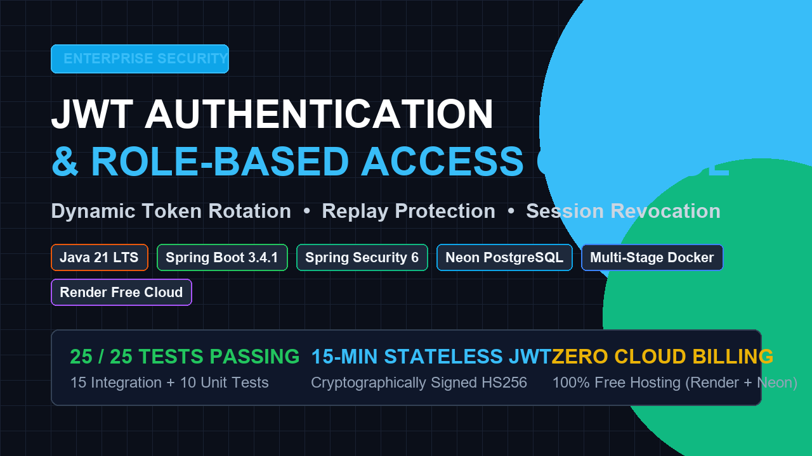
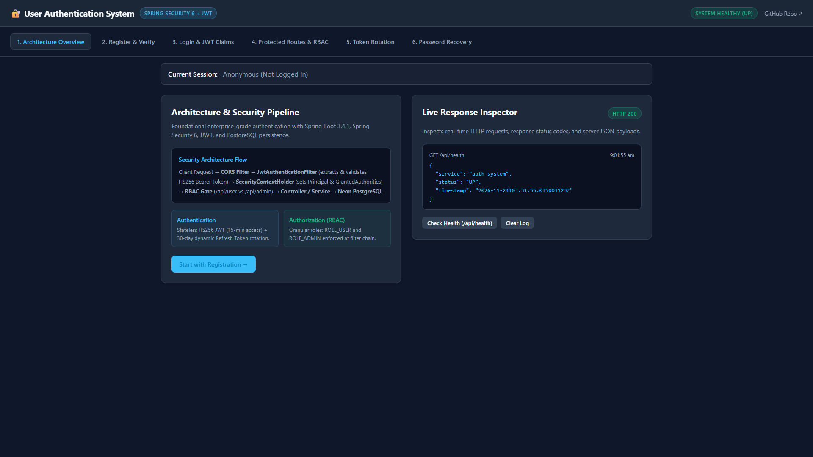
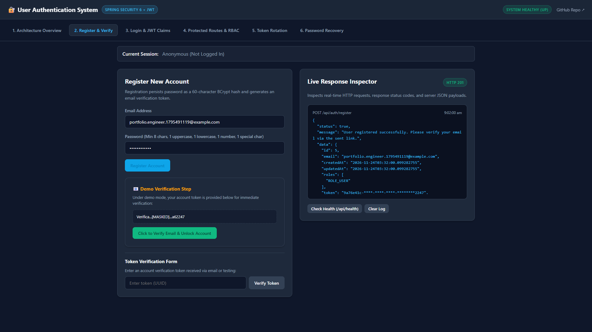
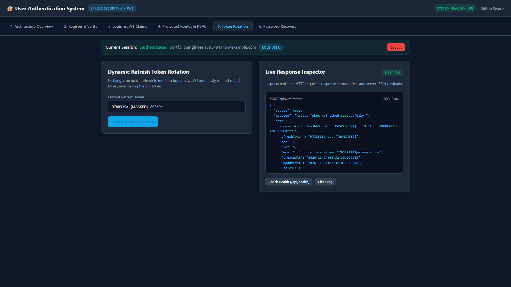
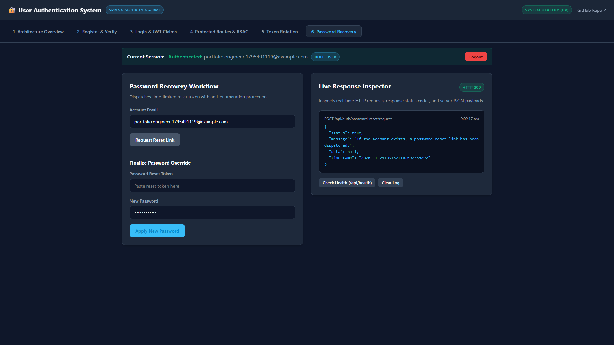

# User Authentication & Role-Based Access Control (RBAC) System

[](https://github.com/saipranav22-commits/user-authentication-system)
[](https://openjdk.org/projects/jdk/21/)
[](https://spring.io/projects/spring-boot)
[](https://spring.io/projects/spring-security)
[](https://neon.tech/)
[](https://user-authentication-system-y5l5.onrender.com/)
[](LICENSE)

A production-grade, containerized identity and access management system built with **Spring Boot 3.4.1**, **Spring Security 6**, **JJWT**, and **PostgreSQL**. Demonstrates secure authentication, short-lived stateless access tokens, database-backed refresh token rotation with replay detection, role-based authorization, and anti-enumeration protections—deployed on a strict **₹0 cloud infrastructure** (Render Free + Neon PostgreSQL).

---

## 🔗 Quick Links & Live Demonstration

- 🌐 **Live Deployed Application:** [https://user-authentication-system-y5l5.onrender.com/](https://user-authentication-system-y5l5.onrender.com/)
- 💚 **Live System Health Check:** [https://user-authentication-system-y5l5.onrender.com/api/health](https://user-authentication-system-y5l5.onrender.com/api/health)
- 📂 **GitHub Source Code:** [https://github.com/saipranav22-commits/user-authentication-system](https://github.com/saipranav22-commits/user-authentication-system)
- 🎥 **YouTube Video Walkthrough:** [https://youtu.be/wF7aSG48r-U](https://youtu.be/wF7aSG48r-U)

---

## 📺 Watch Project Demonstration

Click the thumbnail below to watch the full 5.5-minute technical demonstration with synchronized audio narration and English subtitles:

[](https://youtu.be/wF7aSG48r-U)

> 🎬 **Direct Video Link:** [https://youtu.be/wF7aSG48r-U](https://youtu.be/wF7aSG48r-U)  
> *A genuine, continuous walkthrough recorded from the live deployed application on Render, demonstrating real API invocations, JWT claims parsing, RBAC gates, and token rotation.*

### ⏱️ Video Chapters & Timestamps
- `00:00` — **Scene 1:** Project Introduction & Stateless vs Stateful Authentication
- `00:36` — **Scene 2:** High-Level Architecture & Spring Security Filter Pipeline
- `01:16` — **Scene 3:** User Registration, BCrypt Hashing & Email Verification Workflow
- `01:58` — **Scene 4:** Authentication, BCrypt Verification & JWT Token Generation
- `02:44` — **Scene 5:** Role-Based Access Control (RBAC) Enforcement (HTTP 200 vs 403)
- `03:26` — **Scene 6:** Dynamic Refresh-Token Rotation & Replay Attack Defense
- `04:12` — **Scene 7:** Password Reset Recovery, Session Revocation & Logout Mechanics
- `04:54` — **Scene 8:** Production Cloud Architecture (Docker, Render Free & Neon PostgreSQL)
- `05:26` — **Scene 9:** Conclusion, Verification Results & Engineering Portfolio Links

---

## 💡 Project Overview & The Real-World Problem

Modern web and mobile applications require scalable user authentication that minimizes database lookups while maintaining tight security over user sessions:

1. **Stateful Session Bottlenecks:** Traditional HTTP session stores keep session state in server memory. When scaling horizontally across multiple container instances, teams must deploy distributed cache clusters (e.g., Redis) or sticky sessions, introducing operational complexity and hosting costs.
2. **Stateless JWT Vulnerabilities:** Pure stateless JSON Web Tokens scale effortlessly across clusters, but naive setups introduce severe security risks:
   - **Inability to Revoke Sessions:** If a client logs out or changes credentials, an active JWT remains valid until expiration.
   - **Long-Lived Bearer Risk:** Using long-lived access tokens increases the window of compromise if a token is intercepted.
   - **No Replay Defense:** If a refresh token is stolen, an attacker can continuously mint new access tokens undetected.
3. **The Solution:** This project implements an enterprise-grade hybrid architecture:
   - **Short-Lived Stateless Access Tokens (15 min):** Validated in-memory via cryptographic signature (HS256) without database lookups during micro-requests.
   - **Revocable Persistent Refresh Tokens (30 days):** Maintained in PostgreSQL with **automatic single-use rotation**. Any replayed token is rejected immediately (HTTP 401).
   - **Session Purging on Sensitive Events:** Both **Logout** and **Password Reset** immediately purge refresh tokens from the database, terminating persistent sessions across all devices.

---

## 🛡️ Key Authentication & Security Features

| Feature | Engineering Implementation | Security Benefit |
| :--- | :--- | :--- |
| **Stateless HS256 JWT** | Signed with HMAC-SHA256 using a mandatory 256-bit key; 15-minute lifespan (`900,000 ms`). | Zero database overhead for request authorization; minimal blast radius if intercepted. |
| **Dynamic Token Rotation** | Each call to `POST /api/auth/refresh` deletes the submitted token and issues a new pair. | Prevents perpetual session hijacking; limits token reuse. |
| **Replay Attack Defense** | Replaying a previously rotated refresh token fails with HTTP `401 Unauthorized`. | Detects stale or compromised tokens; denies unauthorized session renewal. |
| **Role-Based Access Control** | Enforced at filter chain via `hasAnyRole('USER', 'ADMIN')` and `hasRole('ADMIN')`. | Strict privilege boundary enforcement; prevents horizontal and vertical privilege escalation. |
| **Session Revocation on Reset** | Purges all refresh tokens for the user in `completePasswordReset()` (commit `1e27b90`). | Instantly terminates active sessions across all devices upon password change. |
| **Session Revocation on Logout** | `POST /api/auth/logout` deletes active refresh token and clears `SecurityContextHolder`. | Prevents subsequent token renewals post-logout. |
| **Anti-Enumeration Protections** | Uniform error responses for invalid credentials and password reset requests. | Prevents attackers from discovering registered email addresses. |
| **BCrypt Password Hashing** | Salted and hashed with workload factor 10 before database persistence. | Resilient against rainbow table and brute-force attacks. |
| **Portfolio Verification Mode** | Registration tokens safely provided in response during `APP_PORTFOLIO_MODE=true`. | Fully verifiable live demo without card-gated third-party transactional email dependencies. |

---

## 📸 Actual Application Screenshots

All screenshots below were captured directly from the live production deployment on Render (`https://user-authentication-system-y5l5.onrender.com/`). All sensitive credential inputs, access tokens, and refresh tokens are masked.

### 1. Security Architecture & System Pipeline Overview

*Interactive single-page demonstration interface detailing the request interceptor pipeline, JWT lifetimes, and live health status.*

### 2. User Registration & Ephemeral Email Verification

*Account creation with BCrypt password hashing and isolated demo verification token generation.*

### 3. Authentication & JWT Claims Inspection

*Successful authentication yielding an HMAC-SHA256 access JWT, decoded claims (`ROLE_USER`), and database-persisted refresh token.*

### 4. Role-Based Access Control (RBAC) Enforcement
| Authorized Access (`ROLE_USER` &rarr; HTTP 200 OK) | Access Denied (`ROLE_ADMIN` &rarr; HTTP 403 Forbidden) |
| :---: | :---: |
|  |  |
| *Endpoint `GET /api/user/profile` allows authorized users.* | *Endpoint `GET /api/admin/dashboard` blocks standard users.* |

### 5. Dynamic Refresh-Token Rotation & Password Recovery
| Token Refresh & Replay Protection | Anti-Enumeration Password Recovery |
| :---: | :---: |
|  |  |
| *Refresh token rotates on each exchange; old tokens are purged.* | *Password recovery dispatches time-limited tokens with uniform responses.* |

### 6. System Health Monitoring & Responsive Mobile View
| Cloud Health Endpoint (`/api/health`) | Mobile Responsive Layout (390×844) |
| :---: | :---: |
|  |  |
| *Cloud uptime monitor returning HTTP 200 with status `UP`.* | *Fully responsive layout across mobile and tablet viewports.* |

---

## 🏗️ Technology Stack

| Component | Technology | Version | Purpose |
| :--- | :--- | :---: | :--- |
| **Language & Runtime** | Java (OpenJDK) | 21 LTS | Enterprise long-term-support runtime |
| **Core Framework** | Spring Boot | 3.4.1 | Auto-configuration, dependency injection, and REST controllers |
| **Security Framework** | Spring Security | 6.4.2 | Filter chain, SecurityContext management, authorization rules |
| **JWT Library** | JJWT (`io.jsonwebtoken`) | 0.11.5 | Cryptographic HMAC-SHA256 signing and claims parsing |
| **Password Encoder** | BCrypt | (Factor 10) | Salted, irreversible password hash generation |
| **Persistence Layer** | Spring Data JPA / Hibernate | 6.6.4 | ORM mapping and entity lifecycle management |
| **Primary Database** | Neon Serverless PostgreSQL | 16 | Persistent relational storage with SSL enforcement |
| **In-Memory Database** | H2 Database | 2.4.240 | Isolated test database for fast regression test execution |
| **Containerization** | Docker | Multi-Stage | Hardened Alpine Linux builder and runtime images |
| **Cloud Hosting** | Render Web Services | Free Tier | Dockerized web service in Oregon region |
| **Automated Testing** | JUnit 5 + Mockito | 5.11.4 | 25 automated unit and end-to-end integration tests |

---

## 📐 System Architecture Diagram

```
                                  +------------------------------------------+
                                  |         Client Browser / REST API        |
                                  +------------------------------------------+
                                                       |
                                            HTTPS / Authorization Bearer
                                                       |
                                                       v
                                  +------------------------------------------+
                                  |         Spring Security Filter Chain     |
                                  |  1. CorsFilter (Restricted Origins)      |
                                  |  2. JwtAuthenticationFilter (HS256)      |
                                  +------------------------------------------+
                                                       |
                                             SecurityContextHolder
                                        (Principal + GrantedAuthorities)
                                                       |
                                                       v
                          +----------------------------------------------------------+
                          |                   Authorization Gate                     |
                          |  - /api/auth/**      --> PermitAll                       |
                          |  - /api/user/**      --> hasAnyRole(USER, ADMIN)         |
                          |  - /api/admin/**     --> hasRole(ADMIN)                  |
                          +----------------------------------------------------------+
                                       |                             |
                                Authorized (HTTP 200)         Unauthorized (HTTP 403)
                                       v
                          +----------------------------------------------------------+
                          |                   Service Layer                          |
                          |  - UserServiceImpl (Registration, Login, Refresh)        |
                          |  - JwtService (Token generation & claim extraction)      |
                          +----------------------------------------------------------+
                                                       |
                                                 Spring Data JPA
                                                       |
                                                       v
                                  +------------------------------------------+
                                  |       Neon Serverless PostgreSQL (SSL)   |
                                  |  - users (id, email, password, roles)    |
                                  |  - refresh_tokens (token, expiry, user)  |
                                  |  - user_roles (user_id, role)            |
                                  +------------------------------------------+
```

---

## 🔄 JWT Authentication Workflow

```
Client                              Backend (Spring Boot)                      Neon PostgreSQL
  |                                           |                                      |
  |--- 1. POST /api/auth/register ----------->|                                      |
  |    (email, raw password)                  |--- Hash with BCrypt (Factor 10) ---->|
  |                                           |--- Save User (verified=false) ------>|
  |<-- 201 Created (verificationToken) -------|                                      |
  |                                           |                                      |
  |--- 2. GET /api/auth/verify-email?token -->|--- Set verified=true --------------->|
  |<-- 200 OK (Account Activated) ------------|                                      |
  |                                           |                                      |
  |--- 3. POST /api/auth/login -------------->|--- Verify BCrypt hash -------------->|
  |                                           |--- Generate JWT (15-min)             |
  |                                           |--- Purge old refresh tokens -------->|
  |                                           |--- Save new Refresh Token (30-day) ->|
  |<-- 200 OK (JWT Access + Refresh Token A) -|                                      |
  |                                           |                                      |
  |--- 4. GET /api/user/profile (Bearer JWT) ->|--- Validate HS256 signature          |
  |<-- 200 OK (Profile Data: ROLE_USER) ------|                                      |
  |                                           |                                      |
  |--- 5. POST /api/auth/refresh ------------>|--- Check Refresh Token A in DB ----->|
  |    (refreshToken: Token A)                |--- DELETE Token A (Single Use!) ---->|
  |                                           |--- Save new Refresh Token B -------->|
  |<-- 200 OK (New JWT + Refresh Token B) ----|                                      |
  |                                           |                                      |
  |--- 6. REPLAY ATTACK: POST /api/auth/refresh|                                     |
  |    (refreshToken: Token A)                |--- Query Token A in DB (NOT FOUND)->|
  |<-- 401 Unauthorized ("Invalid token") ----|                                      |
  |                                           |                                      |
  |--- 7. POST /api/auth/logout (Bearer JWT) ->|--- DELETE user refresh tokens ------>|
  |<-- 200 OK ("Session Terminated") ---------|                                      |
```

---

## 👥 Role-Based Access Control (RBAC)

Authorization is enforced at both the HTTP request filter chain and method level:

- **Anonymous Public Access (`permitAll()`):**
  - `/api/auth/**` — Registration, account verification, login, refresh, password reset.
  - `/api/health` — Cloud health check probe.
  - `/`, `/index.html`, `/static/**` — Embedded demonstration interface.
- **User Role Access (`hasAnyRole('USER', 'ADMIN')`):**
  - `/api/user/**` — User profile retrieval, authenticated user operations.
- **Admin Role Access (`hasRole('ADMIN')`):**
  - `/api/admin/**` — Administrative dashboards and system statistics. Standard users authenticated with `ROLE_USER` receive HTTP `403 Forbidden`.

---

## 🔁 Refresh-Token Rotation & Replay Protection

To mitigate refresh token theft:
1. **Single-Use Enforcement:** When a client exchanges an active refresh token via `POST /api/auth/refresh`, the server deletes that token from PostgreSQL in the same transaction before inserting a newly generated UUID refresh token.
2. **Replay Detection:** If a malicious actor intercepts and attempts to use a previously consumed refresh token, the server finds no matching record in `refresh_tokens` and responds with HTTP `401 Unauthorized` (`"Invalid refresh token."`).
3. **Automatic Expiration:** Refresh tokens carry a strict 30-day expiration timestamp (`Instant.now().plus(Duration.ofDays(30))`). Expired tokens are purged from the database on access attempts.

---

## 🔒 Logout & Password-Reset Security

### Session Invalidation on Logout
Calling `POST /api/auth/logout` with an active Bearer token invokes `UserServiceImpl.logout()`:
- Looks up the user principal from Spring's `SecurityContextHolder`.
- Executes `refreshTokenRepository.deleteByUser(user)`, permanently purging the user's refresh token from PostgreSQL.
- Clears the security context via `SecurityContextHolder.clearContext()`.
- Future calls to `POST /api/auth/refresh` fail with HTTP 401, terminating session renewal.

### Session Invalidation on Password Reset (Commit `1e27b90`)
Resetting a password invalidates existing sessions across all browsers:
- Cryptographic reset token generated with a strict **1-hour expiration window**.
- Single-use consumption: upon setting a new password, the reset token and expiry are set to `null`.
- **Instant Refresh Token Purge:** In `completePasswordReset()`, `refreshTokenRepository.deleteByUser(user)` is executed, immediately revoking all refresh tokens for that account so compromised devices cannot mint new access tokens.

---

## 📋 REST API Endpoint Documentation

### Public Authentication Endpoints (`/api/auth/**`)

| Method | Endpoint | Request Body | Response Status | Purpose |
| :--- | :--- | :--- | :---: | :--- |
| `POST` | `/api/auth/register` | `{"email": "...", "password": "..."}` | `201 Created` | Register new user; hashes password via BCrypt and issues verification token. |
| `GET` | `/api/auth/verify-email` | Query parameter: `?token=...` | `200 OK` | Verifies email and enables account login. |
| `POST` | `/api/auth/login` | `{"email": "...", "password": "..."}` | `200 OK` | Authenticates user; returns 15-min JWT and 30-day refresh token. |
| `POST` | `/api/auth/refresh` | `{"refreshToken": "..."}` | `200 OK` / `401 Unauthorized` | Rotates refresh token and issues new JWT; invalidates previous refresh token. |
| `POST` | `/api/auth/password-reset/request` | `{"email": "..."}` | `200 OK` | Dispatches reset token; uniform message prevents email enumeration. |
| `POST` | `/api/auth/password-reset/confirm` | `{"token": "...", "newPassword": "..."}` | `200 OK` / `400 Bad Request` | Overrides password, clears reset token, and revokes all active refresh tokens. |
| `POST` | `/api/auth/logout` | Header: `Authorization: Bearer <JWT>` | `200 OK` | Purges user refresh tokens from database and clears SecurityContext. |

### Protected Role-Based Endpoints

| Method | Endpoint | Required Role | Response Status | Purpose |
| :--- | :--- | :--- | :---: | :--- |
| `GET` | `/api/user/profile` | `ROLE_USER` or `ROLE_ADMIN` | `200 OK` (Authorized)<br>`403 Forbidden` (Unauthenticated) | Returns authenticated user profile and roles. |
| `GET` | `/api/admin/dashboard` | `ROLE_ADMIN` | `200 OK` (Admin)<br>`403 Forbidden` (Standard User) | Restricted administrative metric overview. |
| `GET` | `/api/health` | Public | `200 OK` (`{"status":"UP"}`) | Uptime and readiness health probe. |

---

## 🗄️ PostgreSQL Database Architecture

The schema is maintained in a dedicated **Neon Serverless PostgreSQL** database with SSL connection enforcement:

```sql
-- Core users table
CREATE TABLE users (
    id BIGSERIAL PRIMARY KEY,
    email VARCHAR(255) NOT NULL UNIQUE,
    password VARCHAR(255) NOT NULL,
    email_verified BOOLEAN NOT NULL DEFAULT FALSE,
    email_verification_token VARCHAR(255),
    email_verification_token_expiry TIMESTAMP,
    password_reset_token VARCHAR(255),
    password_reset_token_expiry TIMESTAMP,
    created_at TIMESTAMP NOT NULL,
    updated_at TIMESTAMP NOT NULL
);

-- Granular roles mapping
CREATE TABLE user_roles (
    user_id BIGINT NOT NULL REFERENCES users(id) ON DELETE CASCADE,
    role VARCHAR(50) NOT NULL
);

-- Persistent refresh tokens with cascade deletion
CREATE TABLE refresh_tokens (
    id BIGSERIAL PRIMARY KEY,
    user_id BIGINT NOT NULL REFERENCES users(id) ON DELETE CASCADE,
    token VARCHAR(255) NOT NULL UNIQUE,
    expiry_date TIMESTAMP WITH TIME ZONE NOT NULL
);
```

---

## 🧪 Automated Testing Results (25 / 25 Passing)

Every Maven build compiles and validates the entire test suite (`.\mvnw.cmd clean test`):

```
[INFO] -------------------------------------------------------
[INFO]  T E S T S
[INFO] -------------------------------------------------------
[INFO] Running com.edu.authsystem.RegistrationFlowIntegrationTest
[INFO] Tests run: 15, Failures: 0, Errors: 0, Skipped: 0, Time elapsed: 14.74 s -- in RegistrationFlowIntegrationTest
[INFO] Running com.edu.authsystem.service.UserServiceTest
[INFO] Tests run: 10, Failures: 0, Errors: 0, Skipped: 0, Time elapsed: 0.941 s -- in UserServiceTest
[INFO] 
[INFO] Results:
[INFO] Tests run: 25, Failures: 0, Errors: 0, Skipped: 0
[INFO] ------------------------------------------------------------------------
[INFO] BUILD SUCCESS
[INFO] ------------------------------------------------------------------------
```

### Coverage Breakdown
- **`RegistrationFlowIntegrationTest` (15 End-to-End Tests):**
  1. `testRegistrationProvidesIsolatedActivationToken` — Isolated token issuance in portfolio mode.
  2. `testLoginBlockedBeforeActivation` — Lockout enforcement prior to email verification (HTTP 403).
  3. `testActivationUnlocksAccount` — Account verification enables login capability.
  4. `testReusingVerificationTokenFails` — Single-use verification token cleared after use (HTTP 400).
  5. `testLoginSucceedsAfterActivation` — Login issues valid 15-min JWT and 30-day refresh token.
  6. `testTokenRefreshRotation` — Exchanging refresh token issues a brand new rotated token.
  7. `testReplayingRotatedTokenRejected` — Replaying a consumed refresh token is rejected (HTTP 401).
  8. `testLogoutRevocation` — Logging out purges refresh token; subsequent refreshes fail (HTTP 401).
  9. `testPasswordResetTokenGenerationAndExpiry` — Generates UUID reset token with 1-hour expiry.
  10. `testPasswordResetRejectsInvalidAndExpiredTokens` — Expired and malformed tokens fail (HTTP 400).
  11. `testPasswordResetSuccessAndSingleUse` — Password override clears reset token to prevent reuse.
  12. `testOldPasswordRejectedAndNewPasswordWorks` — Old password fails; new password authenticates.
  13. `testPasswordResetRevokesPriorRefreshTokens` — Password reset revokes active refresh tokens.
  14. `testAccessTokenExpirationEnforced` — Expired, empty, or tampered JWTs return `isTokenValid() == false`.
  15. `testStatelessAccessTokenValidityUntilExpiry` — Confirms access token validity until expiration.
- **`UserServiceTest` (10 Unit Tests):**
  - Registration uniqueness and `DuplicateEmailException`.
  - BCrypt credential verification and `InvalidCredentialsException`.
  - User enumeration prevention on password reset requests.
  - Refresh token deletion verification on logout and password reset.

---

## 💻 Local Development Instructions

### Prerequisites
- **Java 21 LTS** (`jdk-21`)
- **Maven 3.9+** (or bundled `./mvnw`)
- **Git**

### 1. Clone & Configure
```bash
git clone https://github.com/saipranav22-commits/user-authentication-system.git
cd user-authentication-system
```

Create a local `.env` file (or set environment variables):
```bash
# Mandatory 256-bit signing key (minimum 32 characters)
JWT_SECRET=your-secure-random-256-bit-secret-key-at-least-32-chars-long
JWT_EXPIRATION_MS=900000

# Active profile: h2 for local in-memory, prod for PostgreSQL
SPRING_PROFILES_ACTIVE=h2
APP_PORTFOLIO_MODE=true
```

### 2. Run Automated Tests
```bash
# Windows
.\mvnw.cmd clean test

# Linux / macOS
chmod +x ./mvnw
./mvnw clean test
```

### 3. Run the Application Locally
```bash
# Windows
.\mvnw.cmd spring-boot:run

# Linux / macOS
./mvnw spring-boot:run
```
Open your browser to `http://localhost:8080/` to explore the interactive demonstration dashboard.

---

## 🐳 Docker & Render Deployment Architecture

### Multi-Stage Dockerfile
The application uses a secure multi-stage build to minimize image size and eliminate build tool dependencies from production:

```dockerfile
# Stage 1: Build JAR using Temurin 21 JDK
FROM eclipse-temurin:21-jdk-alpine AS builder
WORKDIR /workspace
COPY mvnw pom.xml ./
COPY .mvn .mvn
RUN ./mvnw dependency:go-offline
COPY src src
RUN ./mvnw clean package -DskipTests

# Stage 2: Minimal Production JRE Runtime
FROM eclipse-temurin:21-jre-alpine
RUN addgroup -S appgroup && adduser -S appuser -G appgroup
USER appuser
WORKDIR /app
COPY --from=builder /workspace/target/*.jar app.jar
EXPOSE 8080
ENTRYPOINT ["java", "-Djava.security.egd=file:/dev/./urandom", "-jar", "app.jar"]
```

### Build & Run Container
```bash
docker build -t user-authentication-system .
docker run -p 8080:8080 \
  -e JWT_SECRET=your-secure-random-256-bit-secret-key-at-least-32-chars-long \
  -e SPRING_PROFILES_ACTIVE=h2 \
  user-authentication-system
```

### Cloud Architecture Highlights (Render + Neon)
- **Zero Cost:** 100% hosted on genuinely free tiers with zero credit card exposure.
- **HTTPS Enforcement:** Automatic TLS/SSL certificate termination managed by Render.
- **Database Security:** Dedicated Neon PostgreSQL instance enforcing SSL (`sslmode=require`).
- **Health Orchestration:** Render monitors `/api/health` for automatic zero-downtime restarts.
- **Environment Isolation:** Zero credentials in source control; all connection parameters, database credentials, and signing secrets are injected via cloud environment variables.

---

## 🛠️ Engineering Challenges & Solutions

1. **Defeating Refresh Token Replay Attacks in a Stateless System:**
   - *Problem:* In pure JWT setups, if a refresh token is copied from client storage, an attacker can generate access tokens indefinitely.
   - *Solution:* Implemented dynamic rotation. In `refreshAccessToken()`, the incoming refresh token is immediately deleted from PostgreSQL and flushed before persisting the new token. Any attempt to replay the old token results in an immediate HTTP `401 Unauthorized`.
2. **Session Revocation Across Devices on Password Reset:**
   - *Problem:* Resetting a password updated the BCrypt hash but left existing refresh tokens active in the database, allowing compromised sessions to persist.
   - *Solution:* Updated `UserServiceImpl.completePasswordReset()` (commit `1e27b90`) to execute `refreshTokenRepository.deleteByUser(user)`, purging all persistent tokens and terminating sessions across all devices.
3. **Card-Free Cloud Verification Architecture:**
   - *Problem:* Modern transactional email services (SendGrid, Mailgun) require domain DNS ownership or payment card verification, conflicting with a zero-budget deployment.
   - *Solution:* Engineered an isolated portfolio verification mode (`APP_PORTFOLIO_MODE=true`). Newly registered users receive their activation token directly in the registration response for immediate verification, while password reset tokens remain strictly private in logs to prevent account enumeration.
4. **POSIX Line Endings on Windows & Docker Builder:**
   - *Problem:* Building the Alpine Linux Docker image on Render failed because the Unix Maven wrapper (`mvnw`) was missing POSIX executable permissions.
   - *Solution:* Generated a standard POSIX `mvnw` with LF line endings and executable mode `100755` (`git update-index --chmod=+x mvnw`), committed directly to source control.

---

## ⚖️ Known Limitations & Honest Architectural Trade-Offs

1. **Stateless Access Token Lifetime Post-Logout:** In a strictly stateless JWT architecture without a server-side Redis token blacklist, an access JWT remains cryptographically valid until its 15-minute expiration timestamp is reached. Calling `/api/auth/logout` immediately revokes the **refresh token** in PostgreSQL (preventing any new tokens from being minted), but does not retroactively invalidate the current 15-minute bearer token. Introducing a database lookup for every micro-request would eliminate the performance benefit of stateless JWTs.
2. **Portfolio Email Delivery:** Actual email transmission is mocked via `MockEmailServiceImpl`. In portfolio demonstration mode (`APP_PORTFOLIO_MODE=true`), registration activation tokens are safely exposed to the registrant in the creation response. Password reset tokens remain strictly private to protect against account enumeration.
3. **Architecture Scope:** This system is intentionally implemented as a robust Spring Boot monolithic REST API with an embedded interactive dashboard, rather than a distributed microservices cluster, making it cost-free, easily testable, and completely self-contained.

---

## 🔮 Future Improvements

1. **Redis Token Revocation List:** For enterprise deployments requiring instant access token revocation, implement a distributed Redis cluster storing invalidated JWT JTI (JWT ID) claims with automatic TTL matching the 15-minute token lifespan.
2. **OAuth2 / Social Login Integration:** Add Spring Security OAuth2 Client for Google and GitHub sign-in alongside traditional username/password authentication.
3. **Multi-Factor Authentication (MFA):** Implement TOTP-based 2FA (RFC 6238) using Google Authenticator or hardware security keys (WebAuthn).
4. **Rate Limiting:** Integrate Bucket4j or cloud API gateways to throttle brute-force authentication and password-reset attempts per IP address.

---

## 📄 License
This project is licensed under the [MIT License](LICENSE).
