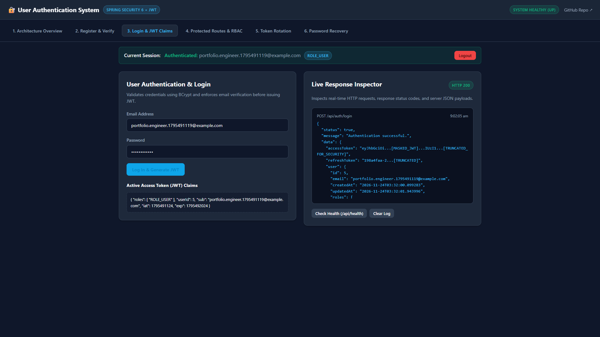
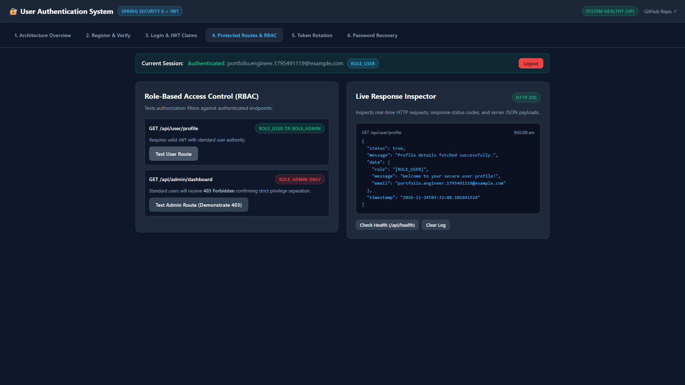
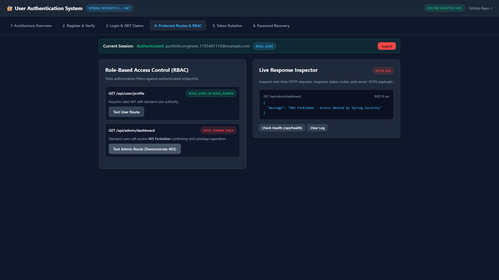
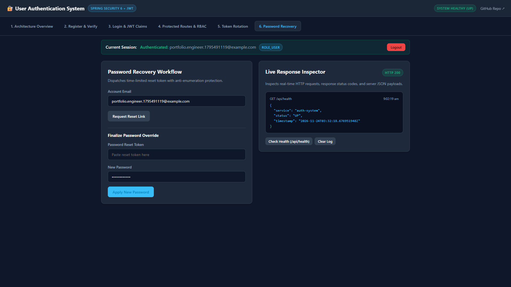
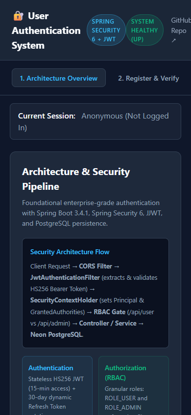

# User Authentication & Role-Based Access Control (RBAC) System

[](https://github.com/saipranav22-commits/user-authentication-system)
[](https://openjdk.org/projects/jdk/21/)
[](https://spring.io/projects/spring-boot)
[](https://spring.io/projects/spring-security)
[-blue?style=flat-square&logo=postgresql)](https://neon.tech/)
[](https://user-authentication-system-y5l5.onrender.com/)
[](LICENSE)

A production-grade, containerized identity and access management backend engineered with **Spring Boot 3.4.1**, **Spring Security 6**, **JJWT**, and **PostgreSQL**. Demonstrates secure authentication, stateless short-lived access tokens, database-backed refresh token rotation with replay detection, role-based authorization, and anti-enumeration protections—deployed on a strict **₹0 cloud infrastructure** (Render Free + Neon PostgreSQL).

---

## 🌐 Live Application & Video Walkthrough

- **Live Deployed Application:** [https://user-authentication-system-y5l5.onrender.com/](https://user-authentication-system-y5l5.onrender.com/)
- **Live Health Status:** [https://user-authentication-system-y5l5.onrender.com/api/health](https://user-authentication-system-y5l5.onrender.com/api/health)
- **GitHub Repository:** [https://github.com/saipranav22-commits/user-authentication-system](https://github.com/saipranav22-commits/user-authentication-system)

### 📹 Technical Demonstration Video
A full 5.5-minute technical walkthrough video (`jwt-authentication-system-demo.mp4`) with synchronized neural narration and English subtitles has been prepared.
- **Local Video Asset:** `docs/demo/final/jwt-authentication-system-demo.mp4` (1080p, 30 FPS, H.264/AAC, 14.3 MB)
- **Subtitles (SRT):** `docs/demo/final/jwt-authentication-system-subtitles.srt`
- **YouTube Metadata & Chapters:** [docs/demo/final/YOUTUBE_METADATA.md](docs/demo/final/YOUTUBE_METADATA.md)
- **YouTube Walkthrough Link:** *(Upload pending; see manual upload instructions in `YOUTUBE_METADATA.md` to publish as Unlisted)*

---

## 📸 Application Screenshots

### 1. Security Architecture & System Pipeline Overview

*Interactive single-page demonstration interface detailing the request interceptor pipeline, JWT lifetimes, and live health status.*

### 2. User Registration & Ephemeral Email Verification

*Account creation with BCrypt password hashing and isolated demo verification token generation.*

### 3. Authentication & JWT Claims Inspection

*Successful authentication yielding an HMAC-SHA256 access JWT, decoded claims (`ROLE_USER`), and database-persisted refresh token.*

### 4. Role-Based Access Control (RBAC) Enforcement
| Authorized Access (`ROLE_USER` &rarr; HTTP 200 OK) | Access Denied (`ROLE_ADMIN` &rarr; HTTP 403 Forbidden) |
| :---: | :---: |
|  |  |
| *Endpoint `GET /api/user/profile` allows authorized users.* | *Endpoint `GET /api/admin/dashboard` blocks standard users.* |

### 5. Dynamic Refresh-Token Rotation & Password Recovery
| Token Refresh & Replay Protection | Anti-Enumeration Password Recovery |
| :---: | :---: |
|  |  |
| *Refresh token rotates on each exchange; old tokens are purged.* | *Password recovery dispatches time-limited tokens with uniform responses.* |

### 6. System Health Monitoring & Responsive View
| Cloud Health Endpoint (`/api/health`) | Mobile Responsive Layout (390×844) |
| :---: | :---: |
|  |  |
| *Cloud uptime monitor returning HTTP 200 with status `UP`.* | *Fully responsive layout across mobile and tablet viewports.* |

---

## 🛡️ Key Authentication & Security Features

1. **Stateless JWT Access Tokens:** 15-minute lifespan (`900,000 ms`), cryptographically signed using HMAC-SHA256 (`Keys.hmacShaKeyFor`) with a mandatory 256-bit secret.
2. **Dynamic Refresh-Token Rotation:** Refresh tokens expire in 30 days and are stored in PostgreSQL. Exchanging a refresh token generates a new token pair while deleting the old refresh token from the database.
3. **Replay Attack Protection:** Replaying an already-consumed refresh token returns HTTP `401 Unauthorized` because the token record was purged during the initial rotation.
4. **Hierarchical RBAC Authorization:** Enforced via Spring Security's `authorizeHttpRequests` DSL. Endpoints under `/api/user/**` require `ROLE_USER` or `ROLE_ADMIN`; `/api/admin/**` requires `ROLE_ADMIN`.
5. **Session Revocation on Password Reset:** Completed in commit `1e27b90`. Resetting a password immediately purges all active refresh tokens for that user from the database, invalidating persistent sessions across all devices.
6. **Session Revocation on Logout:** Calling `POST /api/auth/logout` deletes the authenticated user's refresh token from PostgreSQL and clears the Spring Security context.
7. **Anti-Enumeration Protections:**
   - Login attempts with nonexistent accounts or incorrect passwords return identical `InvalidCredentialsException` (HTTP 401).
   - Password reset requests return identical success messages regardless of whether the submitted email address exists.
8. **BCrypt Password Encryption:** Passwords are never stored in plaintext; salted and hashed using BCrypt (workload factor 10).
9. **Portfolio Mode Verification:** Newly registered accounts receive their verification token directly in the registration response during portfolio demonstration mode (`APP_PORTFOLIO_MODE=true`), eliminating dependencies on card-gated transactional email APIs while keeping password-reset tokens strictly private.

---

## 🏗️ Technology Stack

| Layer | Technology | Details |
| :--- | :--- | :--- |
| **Language & Runtime** | Java 21 LTS | Eclipse Temurin 21 Alpine container base |
| **Framework** | Spring Boot 3.4.1 | Web, Security, Data JPA, Validation |
| **Security Engine** | Spring Security 6.4.2 | Filter chain, SecurityContextHolder, BCrypt |
| **Token Standard** | JJWT (`io.jsonwebtoken 0.11.5`) | HMAC-SHA256 signed access tokens |
| **Persistent Database** | PostgreSQL 16 (Neon Serverless) | SSL required (`sslmode=require`), connection pooling via HikariCP |
| **Testing Database** | H2 In-Memory Database | Isolated profile for automated regression test runs |
| **Containerization** | Docker Multi-Stage | Builder: Temurin 21 JDK; Runtime: Temurin 21 JRE Alpine |
| **Hosting Platform** | Render Free Web Service | Oregon region, automatic continuous deployment from `main` |
| **Automated Testing** | JUnit 5 + Mockito + TestRestTemplate | 25 automated unit and end-to-end integration tests |

---

## 📐 System Architecture Diagram

```
                                  +------------------------------------------+
                                  |         Client Browser / REST API        |
                                  +------------------------------------------+
                                                       |
                                            HTTPS / Authorization Bearer
                                                       |
                                                       v
                                  +------------------------------------------+
                                  |         Spring Security Filter Chain     |
                                  |  1. CorsFilter (Restricted Origins)      |
                                  |  2. JwtAuthenticationFilter (HS256)      |
                                  +------------------------------------------+
                                                       |
                                             SecurityContextHolder
                                        (Principal + GrantedAuthorities)
                                                       |
                                                       v
                          +----------------------------------------------------------+
                          |                   Authorization Gate                     |
                          |  - /api/auth/**      --> PermitAll                       |
                          |  - /api/user/**      --> hasAnyRole(USER, ADMIN)         |
                          |  - /api/admin/**     --> hasRole(ADMIN)                  |
                          +----------------------------------------------------------+
                                       |                             |
                                Authorized (HTTP 200)         Unauthorized (HTTP 403)
                                       v
                          +----------------------------------------------------------+
                          |                   Service Layer                          |
                          |  - UserServiceImpl (Registration, Login, Refresh)        |
                          |  - JwtService (Token generation & claim extraction)      |
                          +----------------------------------------------------------+
                                                       |
                                                 Spring Data JPA
                                                       |
                                                       v
                                  +------------------------------------------+
                                  |       Neon Serverless PostgreSQL (SSL)   |
                                  |  - users (id, email, password, roles)    |
                                  |  - refresh_tokens (token, expiry, user)  |
                                  |  - user_roles (user_id, role)            |
                                  +------------------------------------------+
```

---

## 🔄 Authentication & Refresh-Token Rotation Flow

```
Client                              Backend (Spring Boot)                      Neon PostgreSQL
  |                                           |                                      |
  |--- 1. POST /api/auth/register ----------->|                                      |
  |    (email, raw password)                  |--- Hash with BCrypt (Factor 10) ---->|
  |                                           |--- Save User (verified=false) ------>|
  |<-- 201 Created (verificationToken) -------|                                      |
  |                                           |                                      |
  |--- 2. GET /api/auth/verify-email?token -->|--- Set verified=true --------------->|
  |<-- 200 OK (Account Activated) ------------|                                      |
  |                                           |                                      |
  |--- 3. POST /api/auth/login -------------->|--- Verify BCrypt hash -------------->|
  |                                           |--- Generate JWT (15-min)             |
  |                                           |--- Purge old refresh tokens -------->|
  |                                           |--- Save new Refresh Token (30-day) ->|
  |<-- 200 OK (JWT Access + Refresh Token A) -|                                      |
  |                                           |                                      |
  |--- 4. GET /api/user/profile (Bearer JWT) ->|--- Validate HS256 signature          |
  |<-- 200 OK (Profile Data: ROLE_USER) ------|                                      |
  |                                           |                                      |
  |--- 5. POST /api/auth/refresh ------------>|--- Check Refresh Token A in DB ----->|
  |    (refreshToken: Token A)                |--- DELETE Token A (Single Use!) ---->|
  |                                           |--- Save new Refresh Token B -------->|
  |<-- 200 OK (New JWT + Refresh Token B) ----|                                      |
  |                                           |                                      |
  |--- 6. REPLAY ATTACK: POST /api/auth/refresh|                                     |
  |    (refreshToken: Token A)                |--- Query Token A in DB (NOT FOUND)->|
  |<-- 401 Unauthorized ("Invalid token") ----|                                      |
  |                                           |                                      |
  |--- 7. POST /api/auth/logout (Bearer JWT) ->|--- DELETE user refresh tokens ------>|
  |<-- 200 OK ("Session Terminated") ---------|                                      |
```

---

## 📋 REST API Reference

### Public Authentication Endpoints (`/api/auth/**`)

| Method | Endpoint | Request Body | Response Status | Purpose |
| :--- | :--- | :--- | :---: | :--- |
| `POST` | `/api/auth/register` | `{"email": "...", "password": "..."}` | `201 Created` | Register new user; persists BCrypt hash and issues verification token. |
| `GET` | `/api/auth/verify-email` | Query parameter: `?token=...` | `200 OK` | Verifies email and enables account login. |
| `POST` | `/api/auth/login` | `{"email": "...", "password": "..."}` | `200 OK` | Authenticates user; returns 15-min JWT and 30-day refresh token. |
| `POST` | `/api/auth/refresh` | `{"refreshToken": "..."}` | `200 OK` / `401 Unauthorized` | Rotates refresh token and issues new JWT; invalidates previous refresh token. |
| `POST` | `/api/auth/password-reset/request` | `{"email": "..."}` | `200 OK` | Dispatches reset token; uniform message prevents email enumeration. |
| `POST` | `/api/auth/password-reset/confirm` | `{"token": "...", "newPassword": "..."}` | `200 OK` / `400 Bad Request` | Overrides password, clears reset token, and revokes all active refresh tokens. |
| `POST` | `/api/auth/logout` | Header: `Authorization: Bearer <JWT>` | `200 OK` | Purges user refresh tokens from database and clears SecurityContext. |

### Protected Role-Based Endpoints

| Method | Endpoint | Required Role | Response Status | Purpose |
| :--- | :--- | :--- | :---: | :--- |
| `GET` | `/api/user/profile` | `ROLE_USER` or `ROLE_ADMIN` | `200 OK` (Authorized)<br>`403 Forbidden` (Unauthenticated) | Returns authenticated user profile and roles. |
| `GET` | `/api/admin/dashboard` | `ROLE_ADMIN` | `200 OK` (Admin)<br>`403 Forbidden` (Standard User) | Restricted administrative metric overview. |
| `GET` | `/api/health` | Public | `200 OK` (`{"status":"UP"}`) | Uptime and readiness health probe. |

---

## 🗄️ Database Architecture

The application uses Hibernate DDL validation and update against a dedicated Neon PostgreSQL database.

```sql
-- Core users table
CREATE TABLE users (
    id BIGSERIAL PRIMARY KEY,
    email VARCHAR(255) NOT NULL UNIQUE,
    password VARCHAR(255) NOT NULL,
    email_verified BOOLEAN NOT NULL DEFAULT FALSE,
    email_verification_token VARCHAR(255),
    email_verification_token_expiry TIMESTAMP,
    password_reset_token VARCHAR(255),
    password_reset_token_expiry TIMESTAMP,
    created_at TIMESTAMP NOT NULL,
    updated_at TIMESTAMP NOT NULL
);

-- Granular roles mapping
CREATE TABLE user_roles (
    user_id BIGINT NOT NULL REFERENCES users(id) ON DELETE CASCADE,
    role VARCHAR(50) NOT NULL
);

-- Persistent refresh tokens with cascade deletion
CREATE TABLE refresh_tokens (
    id BIGSERIAL PRIMARY KEY,
    user_id BIGINT NOT NULL REFERENCES users(id) ON DELETE CASCADE,
    token VARCHAR(255) NOT NULL UNIQUE,
    expiry_date TIMESTAMP WITH TIME ZONE NOT NULL
);
```

---

## 🧪 Automated Test Suite (25 / 25 Passing)

Every build compiles and executes unit and integration test suites via Maven (`mvn clean test`):

```
[INFO] -------------------------------------------------------
[INFO]  T E S T S
[INFO] -------------------------------------------------------
[INFO] Running com.edu.authsystem.RegistrationFlowIntegrationTest
[INFO] Tests run: 15, Failures: 0, Errors: 0, Skipped: 0, Time elapsed: 14.74 s -- in RegistrationFlowIntegrationTest
[INFO] Running com.edu.authsystem.service.UserServiceTest
[INFO] Tests run: 10, Failures: 0, Errors: 0, Skipped: 0, Time elapsed: 0.941 s -- in UserServiceTest
[INFO] 
[INFO] Results:
[INFO] Tests run: 25, Failures: 0, Errors: 0, Skipped: 0
[INFO] ------------------------------------------------------------------------
[INFO] BUILD SUCCESS
[INFO] ------------------------------------------------------------------------
```

### Test Suite Highlights
- **`RegistrationFlowIntegrationTest` (15 end-to-end tests):**
  1. Registration token generation and isolation.
  2. Account login lockout prior to activation (HTTP 403).
  3. Account activation unlocking login capability.
  4. Single-use activation token reuse rejection (HTTP 400).
  5. Login issuing valid JWT access and refresh tokens.
  6. Dynamic refresh-token rotation producing successor tokens.
  7. Replay attack rejection when submitting consumed refresh tokens (HTTP 401).
  8. Logout session invalidation preventing further refreshes (HTTP 401).
  9. Password reset token generation with 1-hour expiry.
  10. Rejection of invalid and expired reset tokens (HTTP 400).
  11. Successful password override with single-use token consumption.
  12. Rejection of old password and acceptance of new password on login.
  13. Password reset revoking prior refresh tokens across all sessions.
  14. Access token signature and malformed token rejection.
  15. Stateless access token mathematical validity until expiration.
- **`UserServiceTest` (10 unit tests):**
  - Duplicate email collision handling (`DuplicateEmailException`).
  - BCrypt password mismatch handling (`InvalidCredentialsException`).
  - Anti-enumeration silent ignores on nonexistent password reset requests.
  - Refresh token deletion verification on logout and password reset.

---

## ⚖️ Known Limitations & Honest Architectural Trade-Offs

1. **Stateless Access Token Window Post-Logout:** In a strictly stateless JWT architecture without a server-side Redis token blacklist, an access JWT remains cryptographically valid until its 15-minute expiration timestamp is reached. Calling `/api/auth/logout` revokes the persistent **refresh token** in PostgreSQL, preventing any new access tokens from being minted, but does not retroactively invalidate the current 15-minute bearer token. Introducing a server-side blacklist introduces database overhead to every API request, defeating the performance benefit of stateless JWTs.
2. **Demonstration Email Channel:** Because transactional SMTP services (e.g., SendGrid, Mailgun) require domain DNS ownership or payment card verification, emails are simulated via `MockEmailServiceImpl`. In portfolio demonstration mode (`APP_PORTFOLIO_MODE=true`), registration activation tokens are safely exposed to the registrant in the creation response. Password reset tokens remain strictly private in logs and responses to prevent account takeovers.
3. **Architecture Scope:** This system is intentionally implemented as a robust Spring Boot monolithic REST API with an embedded interactive dashboard, rather than a distributed microservices cluster, making it cost-free, easily testable, and completely self-contained.

---

## 💻 Local Setup & Development

### Prerequisites
- Java 21 LTS (`jdk-21`)
- Maven 3.9+ (or use bundled `./mvnw`)
- Git

### 1. Clone the Repository
```bash
git clone https://github.com/saipranav22-commits/user-authentication-system.git
cd user-authentication-system
```

### 2. Configure Environment Variables
Create a local `.env` file (or set environment variables in your shell):
```bash
# JWT Configuration (Mandatory: minimum 32 characters / 256 bits)
JWT_SECRET=your-secure-random-256-bit-secret-key-at-least-32-chars-long
JWT_EXPIRATION_MS=900000

# Spring Active Profile (h2 for local in-memory, prod for PostgreSQL)
SPRING_PROFILES_ACTIVE=h2
APP_PORTFOLIO_MODE=true
```

### 3. Run the Automated Tests
```bash
# Windows
.\mvnw.cmd clean test

# Linux / macOS
chmod +x ./mvnw
./mvnw clean test
```

### 4. Run the Application Locally
```bash
# Windows
.\mvnw.cmd spring-boot:run

# Linux / macOS
./mvnw spring-boot:run
```
The application will launch at `http://localhost:8080/`. Open your browser to access the interactive demonstration dashboard.

---

## 🐳 Docker Deployment

The application includes a hardened multi-stage `Dockerfile`:

```dockerfile
# Stage 1: Build JAR using Temurin 21 JDK
FROM eclipse-temurin:21-jdk-alpine AS builder
WORKDIR /workspace
COPY mvnw pom.xml ./
COPY .mvn .mvn
RUN ./mvnw dependency:go-offline
COPY src src
RUN ./mvnw clean package -DskipTests

# Stage 2: Minimal Production JRE Runtime
FROM eclipse-temurin:21-jre-alpine
RUN addgroup -S appgroup && adduser -S appuser -G appgroup
USER appuser
WORKDIR /app
COPY --from=builder /workspace/target/*.jar app.jar
EXPOSE 8080
ENTRYPOINT ["java", "-Djava.security.egd=file:/dev/./urandom", "-jar", "app.jar"]
```

### Build & Run Container
```bash
docker build -t user-authentication-system .
docker run -p 8080:8080 \
  -e JWT_SECRET=your-secure-random-256-bit-secret-key-at-least-32-chars-long \
  -e SPRING_PROFILES_ACTIVE=h2 \
  user-authentication-system
```

---

## 🚀 Cloud Production Deployment (Render + Neon)

This project is deployed on **Render Free Web Services** connected to a **Neon Serverless PostgreSQL** database.

### Cloud Architecture Highlights:
- **Build Target:** Native Docker container built directly from `main` branch.
- **HTTPS Enforcement:** Automatic TLS/SSL termination by Render.
- **Database Connection:** Neon PostgreSQL with SSL enforced (`sslmode=require`).
- **Health Check Path:** `/api/health` monitored by Render's health orchestrator.
- **Secrets Management:** Injected exclusively via Render Cloud Environment Variables:
  - `SPRING_DATASOURCE_URL`: Encrypted JDBC connection string with SSL parameters.
  - `SPRING_DATASOURCE_USERNAME`: Managed database user.
  - `SPRING_DATASOURCE_PASSWORD`: Managed database password.
  - `JWT_SECRET`: 256-bit cryptographically random key.
  - `APP_PORTFOLIO_MODE`: `true`.
  - `SPRING_PROFILES_ACTIVE`: `prod`.

---

## 🔮 Future Improvements

1. **Redis Token Revocation List:** For enterprise deployments requiring instant access token revocation, implement a distributed Redis cluster storing invalidated JWT JTI (JWT ID) claims with automatic TTL.
2. **OAuth2 / Social Login Integration:** Add Spring Security OAuth2 Client for Google and GitHub sign-in alongside username/password authentication.
3. **Multi-Factor Authentication (MFA):** Implement TOTP-based 2FA (RFC 6238) using Google Authenticator or hardware security keys (WebAuthn).
4. **Rate Limiting:** Integrate Bucket4j or cloud API gateways to throttle brute-force authentication and password-reset attempts per IP address.

---

## 📄 License
This project is licensed under the [MIT License](LICENSE).
